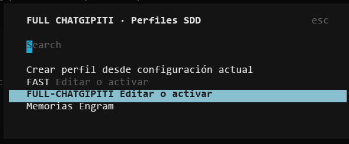
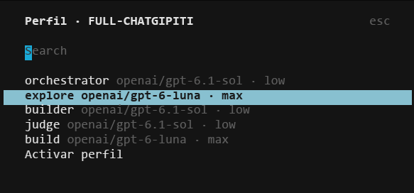

# SDD-Profiles

OpenCode V2 CLI plugin for creating, editing and activating model/reasoning profiles for `orchestrator`, `builder`, `judge`, `build` and `explore`. `/subagents` displays agent purposes and configured models; `/sdd` opens profiles and the Engram memory browser.

## Screenshots





## Install

Requires OpenCode V2 (plugin API 2.0.26) and Node.js 22+ for setup/tests. This package is not published to npm.

```sh
git clone https://github.com/Thiago-P05/SDD-Profiles.git
cd SDD-Profiles
npm ci --ignore-scripts --omit=optional
npm test
```

Merge the CLI-only plugin into global `~/.config/opencode/cli.json` (or your `XDG_CONFIG_HOME` equivalent), preserving existing settings:

```json
{ "plugins": ["/absolute/path/SDD-Profiles"] }
```

OpenTUI/Solid peers come from the OpenCode CLI host; optional peers are omitted for headless checks. Start a new interface; use `/sdd` or `/subagents`. Remove the plugin entry to disable.

## Requirements and side effects

**Back up configuration before activating a profile.** Activation writes global `~/.config/opencode/opencode.jsonc` and the existing `agent/orchestrator.md`, `agent/builder.md`, `agent/judge.md` files. Those files and all five catalog agents must already exist. It does not scaffold agent instructions. JSONC edits preserve unrelated fields with rollback on write failure, but are not a substitute for backups.

Profiles are saved in `~/.config/opencode/full-chatgipiti-profiles/` (legacy directory/UI identifiers retained for compatibility). The implementation does not redirect these paths using `XDG_CONFIG_HOME`; do not use activation with a different global config layout. Restart/reload OpenCode normally after activation; model variants must be supported by your provider. Local CLI paths refer to the local filesystem even when connected to a remote server.

The optional memory browser reads `.engram/config.json` project name or the current directory name, and fetches up to 50 recent observations from `127.0.0.1:${ENGRAM_PORT:-7437}`. If unavailable it attempts to start an installed `engram serve` process detached. It does not stop that service. Opening memories may reveal sensitive retained content on screen; this plugin does not redact, delete or control Engram retention. No quota/account credentials are read.

## Checks and credits

`npm test` uses fixtures/mocks, including simulated filesystem rollback and Engram startup; no real config is modified and no server is started. Terminal rendering and live activation are not certified by Node tests.

Related project reviewed: [j0k3r-dev-rgl/sdd-engram-plugin](https://github.com/j0k3r-dev-rgl/sdd-engram-plugin), MIT. Similar profile/memory functionality is not proof of copied code; see [NOTICE](NOTICE) for the review scope and preserved upstream notice.

MIT — [LICENSE](LICENSE). [V2 CLI plugins](https://opencode.ai/v2/docs/cli/plugins) · [Repository](https://github.com/Thiago-P05/SDD-Profiles).
